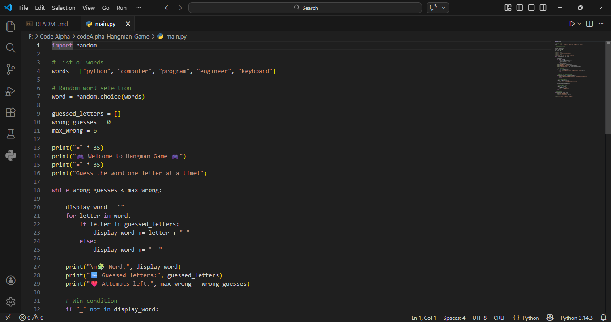
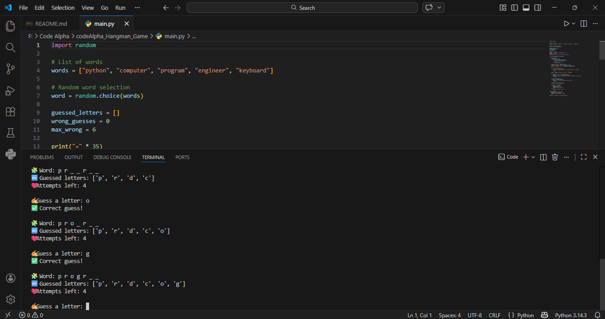

### 🎮 Hangman Game in Python

This project is a console-based Hangman game built using Python.
The player tries to guess a hidden word by entering one letter at a time.

The game randomly selects a word from a predefined list, and the player has a limited number of attempts to guess the correct word.

### 🚀 Features

•🎲 Random word selection using Python random module

• 🔤 Letter-by-letter guessing system

• ❤️ Limited attempts (6 wrong guesses allowed)

• ⚠️ Input validation (prevents numbers or symbols)

• 📋 Displays guessed letters

• 🎉 Win and 💀 Game Over messages

• 🎮 Interactive console interface with emojis

🛠 Technologies Used

• Python

• Random Module

• Loops and Conditional Statements

## 📸 Game Screenshot

